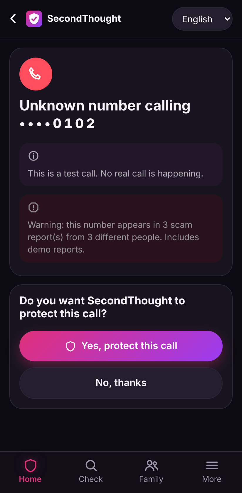
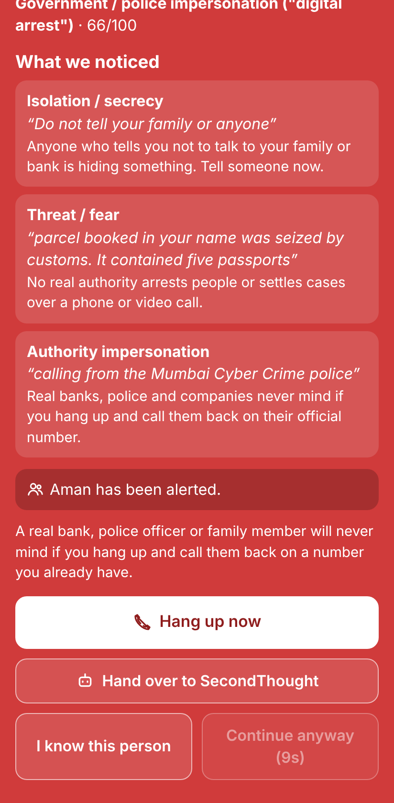
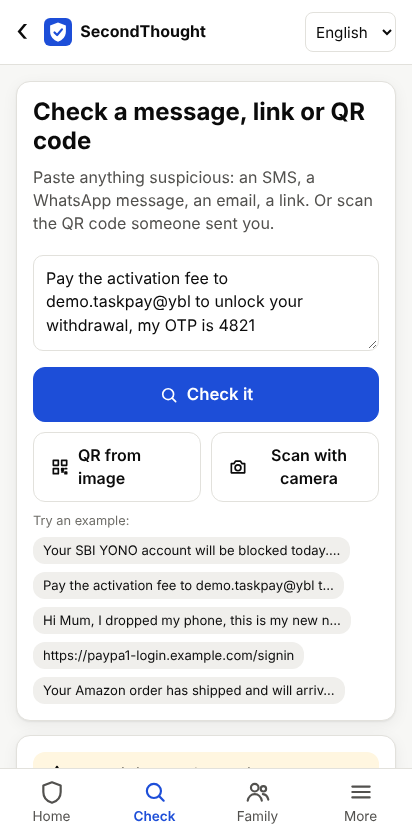
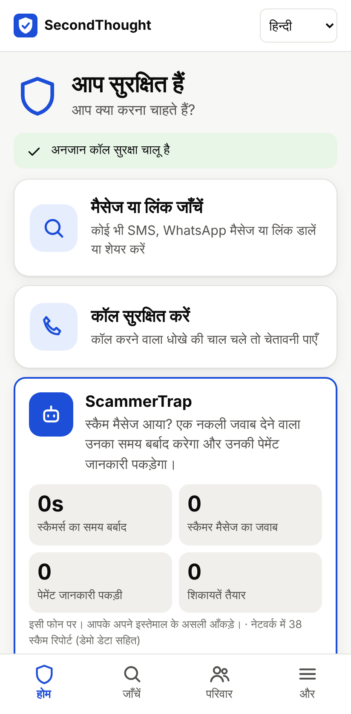

# SecondThought for Android

**Team NeuroNova · INNOVEX 2026 · Problem Statement 05 (AI-Powered Cybersecurity)**

SecondThought spots the manipulation tricks scammers use in calls and messages, such as fake police, "don't tell anyone", "share the OTP" and "pay now or be arrested". It stops the person before any money moves.

This repository is the Android app. The detection engine (rules, trained models, LLM second opinion, scam-report network) runs on the SecondThought server in the main project repository, and the app talks to it over HTTPS.

**Install:** `release/SecondThought-1.0-debug.apk` (Android 7+; unknown-caller protection needs Android 10+).

## What it does

| | |
|---|---|
| **Unknown caller? It asks first.** | When a number that is **not in your contacts** calls, a notification asks: *"Unknown number calling. Protect this call?"* It already shows whether the number appears in scam reports. Nothing happens unless you say yes. |
| **Saved contacts are never touched** | Android only gives a call-screening app calls from numbers that are not in the contacts (`CallScreeningService`, Android 10+). Calls from family and friends never reach SecondThought's code. |
| **Easy for every age** | Three big buttons: *Check a message*, *Protect a call*, *Help! Alert my family*. Four tabs, large text option, and English, हिन्दी and Español. |
| **During a call** | After "Yes, protect this call": safety tips, **Help**, **Type what the caller says**, **Make a payment** (payment pause), **Hand over to SecondThought**, **I know this person**, **End & report**. |
| **Stop screen** | When a conversation crosses the risk line, a full-screen warning lists the tricks it noticed in plain words: *Hang up now*, *Hand over to SecondThought*, or a 10-second wait before continuing. |
| **Help! Alert my family** | One tap prepares a text to your family member ("I'm getting a suspicious call from a number ending 4612… please call me now") and shows a big **Call** button. Their number is saved only on your phone, and it works without internet. |
| **Live family alerts (optional)** | If the family member also has SecondThought, they get a live alert the moment a call turns dangerous: the warning only, never the conversation. |
| **Check anything** | Paste text, or use **Share → SecondThought** from WhatsApp, SMS or email. You can also scan a QR code. The answer is *Scam*, *Suspicious* or *Looks safe*, with the reasons. |
| **Payment pause** | A cooling-off check before paying someone mentioned in a risky conversation. |
| **Honeypot** | Hand the scammer over to an AI that wastes their time and collects their payment details. |
| **Scam network and report** | Scammer identifiers (UPI IDs, accounts, numbers, links) link reports into campaigns. A ready complaint report can be shared to cybercrime.gov.in / 1930. |
| **All web features** | Practice scam calls, intel graph and accuracy results are under **More**. |

## Privacy, by design

1. **It asks first, every time.** For each unknown call the notification asks whether to protect it, and the app asks again before doing anything.
2. **Calls are never listened to or recorded.** The app has no microphone permission at all. During a call you can type what the caller says, and only that text is checked.
3. **Text is masked on arrival** (OTPs, card, Aadhaar and PAN numbers, your own number, UPI ID and account). It is analysed in memory and never saved. A scammer's details go into the shared network only if you agree.
4. The caller check sends the number once and **stores nothing**. The lock-screen notification shows only the last 4 digits.

## How the native parts work

```
android/app/src/main/java/app/secondthought/guardian/
  ScreeningService.java     CallScreeningService: lets every call ring normally, then posts the question
  CallNotifier.java         "Unknown number calling. Protect this call?" + family alert notifications
  CallerCheck.java          is this number in scam reports? (GET /api/graph/lookup, nothing stored)
  SecondThoughtPlugin.java  bridge to the UI: call-screening role, notifications,
                            test call, share sheet, text/call a family member,
                            notification taps / shared text -> app screen
  LaunchQueue.java          routes notification taps and "Share to SecondThought" into the app
  DismissReceiver.java      "Not now"
src/                        the app UI (React); pages/Home, Incoming, Setup, More, Family are app-only
```

The UI is a React app bundled inside the APK with Capacitor 8. API calls go to `VITE_API_BASE` (see `.env.production`).

## Build

You need Node 20+, JDK 21 and the Android SDK (platform 36).

```bash
npm install
npm run apk          # vite build -> cap sync -> gradlew assembleDebug
# APK: android/app/build/outputs/apk/debug/app-debug.apk
```

To use your own server, set `VITE_API_BASE` in `.env.production` and `api_base` in `android/app/src/main/res/values/strings_app.xml`.

## Install and try it

```bash
adb install -r release/SecondThought-1.0-debug.apk
```
You can also drag the APK onto the scrcpy window.

1. Open the app. Setup asks for notifications, then "Ask me when an unknown number calls". This opens Android's *call screening app* dialog: choose SecondThought.
2. Tap **Try a test call** on the home screen. A test "Unknown number calling" notification appears after 3 seconds, and the number is one that has been reported. Tap **Protect this call** → **Play this scam call (demo)** to see the Stop screen.
3. For a real test, call the phone from a number that is **not** saved in its contacts. Then call it from a saved contact: no prompt appears.
4. Add a family member's number in **Family**, then press **Help!**: your messages app opens with the text ready, and **Call** opens the dialler.
5. Live alerts: on a second phone, open **Family → I want alerts about someone else** and enter the pairing code. Then play the demo scam call on the first phone.

The free server sleeps when idle, so the first request can take up to a minute. The app shows *"Connecting…"* while it waits.

## Screenshots

`screenshots/preview/` was rendered from this app's UI in a phone-sized browser, with a stand-in for the Android bridge (`src/native_mock.js`, never included in the APK). Real-device screenshots go in `screenshots/device/` (see `docs/DEMO_VIDEO.md`).

| Setup | Home | Unknown caller | Protected | Stop screen |
|---|---|---|---|---|
|  |  |  |  |  |
| **Help → text ready** | **Check a message** | **Type what the caller says** | **Live family alert** | **Hindi** |
|  |  |  |  |  |

## Limits (said plainly)

- Android doesn't let ordinary apps hear calls, so SecondThought doesn't listen to calls: during a real call you type what the caller says. The simulated scam call shows the full live-detection experience. Live call analysis would need a carrier or "add SecondThought to the call" (conference) integration.
- Call screening needs Android 10+, and the person must pick SecondThought as the call-screening app. Only one app can hold that role, so it replaces Truecaller's screening if that was chosen.
- Help uses a normal text message that the person sends with one tap (apps can't send texts silently without a restricted permission).
- Live family alerts arrive while the guardian's app is open or in recent use, and the free server forgets pairings when it restarts. Always-on alerts need push messaging (FCM), which is the next step.
- This is a debug build (not signed for the Play Store).

## Credits

Message model trained partly on *ScamShield: Multilingual Smishing Social Engn* (Kaggle, siddharthrane07, MIT License). Demo scam reports are synthetic and use fictional identifiers.
