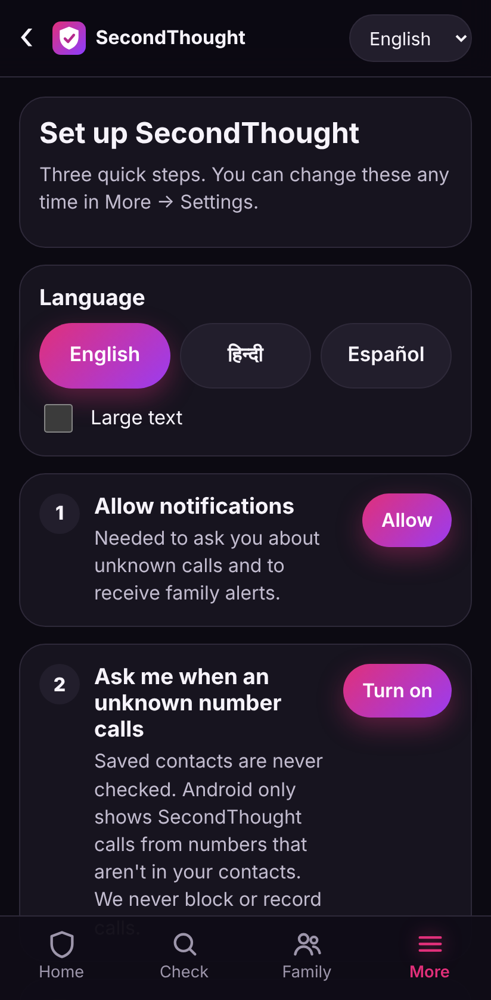
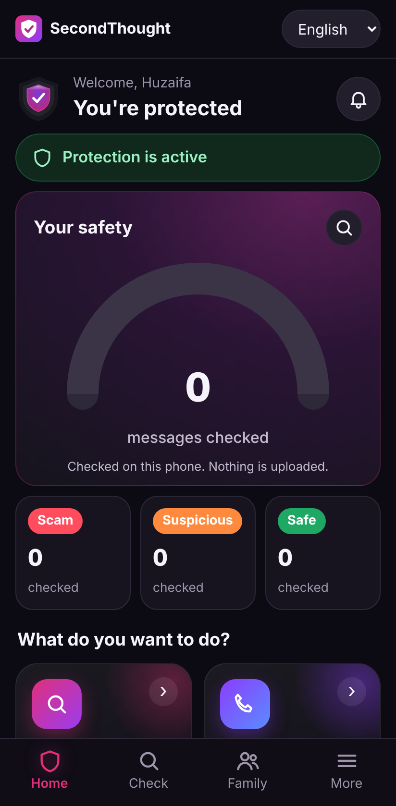
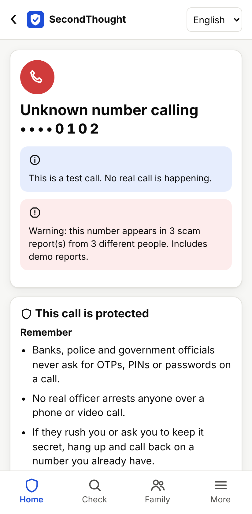
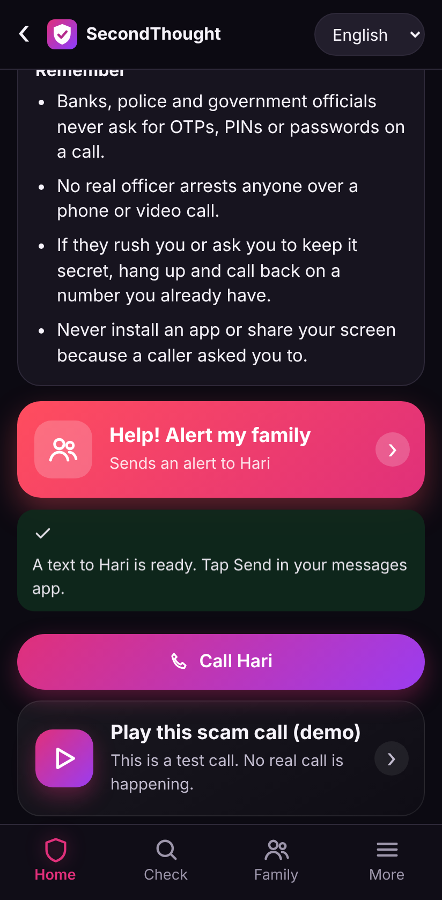
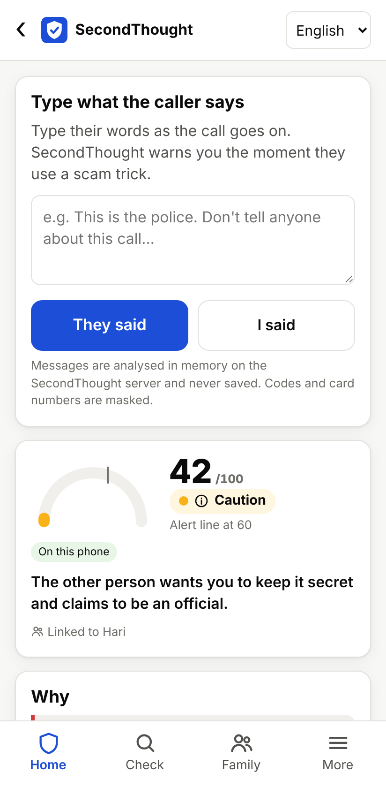
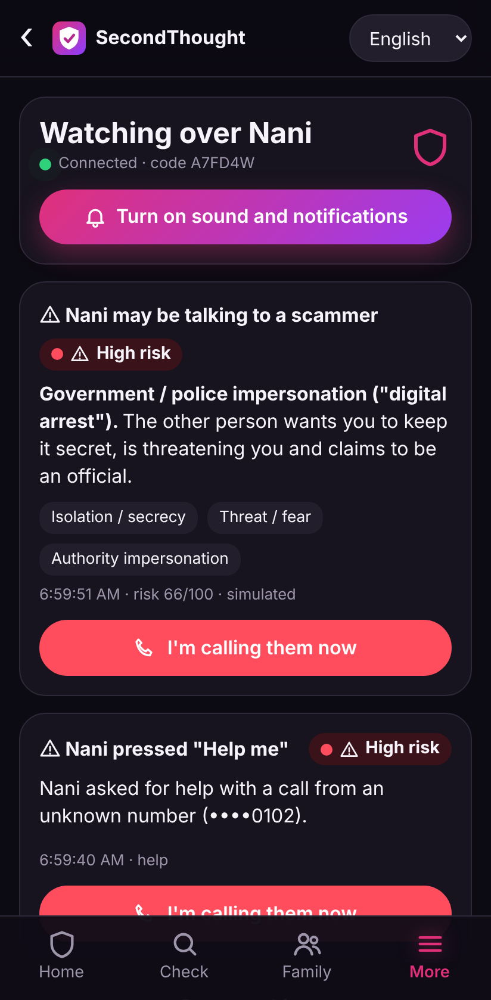
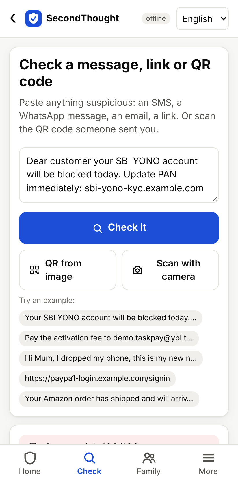
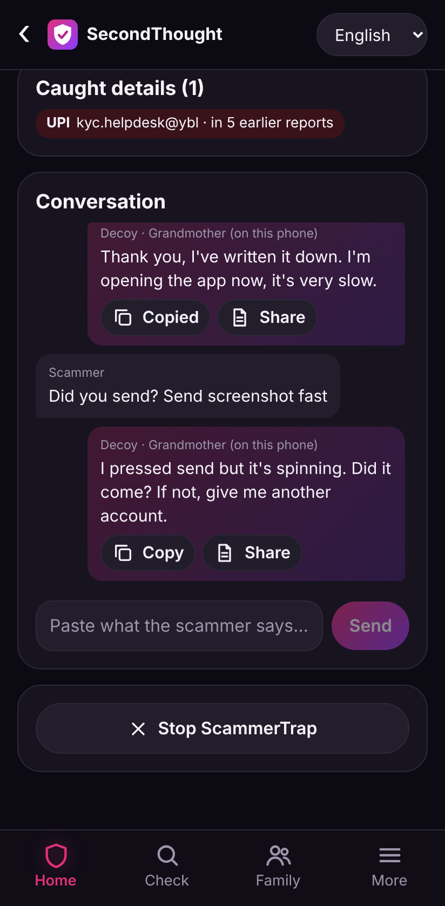
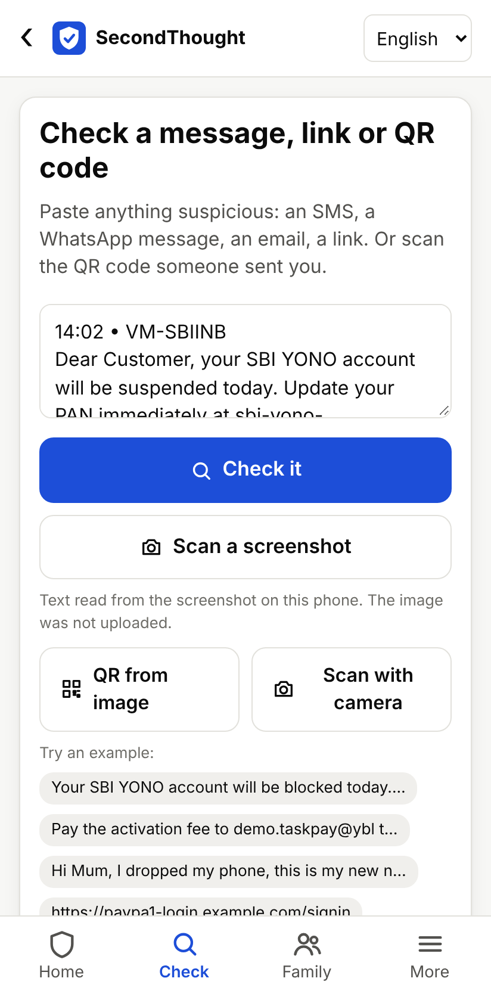
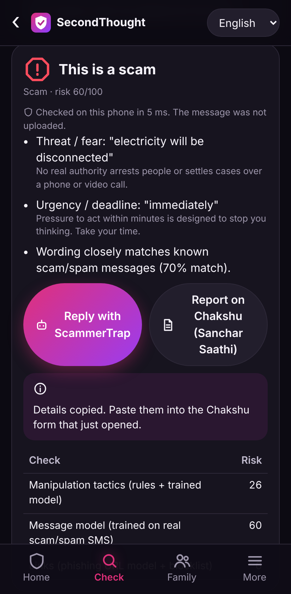

# SecondThought for Android

**Team NeuroNova · INNOVEX 2026 · Problem Statement 05 (AI-Powered Cybersecurity)**

SecondThought spots the manipulation tricks scammers use in calls and messages, such as fake police, "don't tell anyone", "share the OTP" and "pay now or be arrested". It stops the person before any money moves.

This repository is the Android app. **Detection runs on the phone:** the same rules and trained models as the
SecondThought server (main project repository) run inside the app, so checks are instant, work in airplane mode, and
the message never leaves the phone. The server is used only for live family alerts, ScammerTrap, complaint reports and
the scam-report network. See [docs/ON_DEVICE.md](docs/ON_DEVICE.md).

**Install:** `release/SecondThought-1.0-debug.apk` (version 1.3.2; Android 7+; unknown-caller protection needs Android 10+).

> **On-device = server, proven:** 100% same verdict on 7,339 messages (incl. 7,275 real Kaggle ScamShield messages never
> used in training), 39/39 conversations turn by turn, 6,005 links. About 2 ms per check. `npm run parity` re-runs it.

## What it does

| | |
|---|---|
| **Unknown caller? It asks first.** | When a number that is **not in your contacts** calls, a notification asks: *"Unknown number calling. Protect this call?"* It already shows whether the number appears in scam reports. Nothing happens unless you say yes. |
| **Saved contacts are never touched** | Android only gives a call-screening app calls from numbers that are not in the contacts (`CallScreeningService`, Android 10+). Calls from family and friends never reach SecondThought's code. |
| **Easy for every age** | Three big buttons: *Check a message*, *Protect a call*, *Help! Alert my family*. Four tabs, large text option, and English, हिन्दी and Español. |
| **Works offline, on the phone** | Message check, screenshot scan, typed call, simulated call, Stop screen, payment pause and Help all work in airplane mode. Nothing you check is uploaded. |
| **During a call** | After "Yes, protect this call": safety tips, **Help**, **Type what the caller says**, **Make a payment** (payment pause), **Hand over to ScammerTrap**, **I know this person**, **End & report**. |
| **Stop screen** | When a conversation crosses the risk line, a full-screen warning lists the tricks it noticed in plain words: *Hang up now*, *Hand over to ScammerTrap*, or a 10-second wait before continuing. |
| **Help! Alert my family** | One tap prepares a text to your family member ("I'm getting a suspicious call from a number ending 4612… please call me now") and shows a big **Call** button. Their number is saved only on your phone, and it works without internet. |
| **Live family alerts (optional)** | The family member installs SecondThought and scans your family QR code (or types the code) in **Family**. They get a live alert the moment a call turns dangerous: the warning only, never the conversation. |
| **Check anything** | Paste text, **scan a screenshot**, or use **Share → SecondThought** from WhatsApp, SMS, email or the gallery (text or screenshots). QR codes too. The answer is *Scam*, *Suspicious* or *Looks safe*, with the reasons. Screenshot text is read on the phone (English and Hindi script). |
| **Payment pause** | A cooling-off check before paying someone mentioned in a risky conversation. |
| **ScammerTrap (fights back)** | On the home screen. A decoy runs **on the phone**: a **trained model** recognises what the scammer is doing in each message (26 situations, e.g. loan offer, "call this number", OTP request, "did you pay?"), and the decoy answers in kind (lottery: *"How do I claim it?"*, police: *"Please don't arrest me"*, OTP request: refuses without a number), in English, Hinglish, Hindi or Spanish, to waste their time and catch their payment details. Copy or share each reply back to the scammer. Works offline. Live counters: time wasted, messages answered, payment details caught, complaints prepared (real numbers from your own use). Samples: [docs/SCAMMERTRAP.md](docs/SCAMMERTRAP.md). |
| **Scam network and report** | Scammer identifiers (UPI IDs, accounts, numbers, links) link reports into campaigns. A ready complaint report for cybercrime.gov.in / 1930, and one-tap **Report on Chakshu (Sanchar Saathi)** with the details copied for the form. |
| **More** | Practice scam calls, alerts for someone you protect, and the scam network. (Accuracy numbers are for judges and developers: see the Results section and `docs/ON_DEVICE.md`, not shown to app users.) |

## Privacy, by design

1. **It asks first, every time.** For each unknown call the notification asks whether to protect it, and the app asks again before doing anything.
2. **Calls are never listened to or recorded.** The app has no microphone permission at all. During a call you can type what the caller says, and only that text is checked.
3. **Checks run on the phone.** Messages, screenshots and typed calls are analysed inside the app. Only identifiers a scammer gave (UPI IDs, numbers, links) are looked up in the scam-report network, when online.
4. **The server sees a conversation only when you need it:** to alert a linked family member (only after the phone has found a scam), or for a complaint report. ScammerTrap runs on the phone. Codes, card, Aadhaar and PAN numbers and your own details are masked on arrival, and nothing is saved.
5. The caller check sends the number once and **stores nothing**. The lock-screen notification shows only the last 4 digits.

## How the native parts work

```
android/app/src/main/java/app/secondthought/guardian/
  ScreeningService.java     CallScreeningService: lets every call ring normally, then posts the question
  CallNotifier.java         "Unknown number calling. Protect this call?" + family alert notifications
  CallerCheck.java          is this number in scam reports? (GET /api/graph/lookup, nothing stored)
  ScreenshotReader.java     on-device text recognition for screenshots (Google ML Kit, bundled models)
  SecondThoughtPlugin.java  bridge to the UI: call-screening role, notifications,
                            test call, share sheet, text/call a family member,
                            notification taps / shared text -> app screen
  LaunchQueue.java          routes notification taps and "Share to SecondThought" into the app
  DismissReceiver.java      "Not now"
src/                        the app UI (React); pages/Home, Incoming, Setup, More, Family are app-only
src/engine/                 on-device detection: rules, TF-IDF + logistic-regression models, XGBoost link model
tools/export_engine.py      exports the server's rules and trained models into public/engine/
tools/parity.mjs            proves the app gives the same answers as the server
```

The UI is a React app bundled inside the APK with Capacitor 8. API calls go to `VITE_API_BASE` (see `.env.production`).

## Build

You need Node 20+, JDK 21 and the Android SDK (platform 36).

```bash
npm install
npm run apk          # vite build -> cap sync -> gradlew assembleDebug
# APK: android/app/build/outputs/apk/debug/app-debug.apk
```

To use your own server, set `VITE_API_BASE` in `.env.production` and `api_base` in `android/app/src/main/res/values/strings_app.xml`.

## Install and try it

```bash
adb install -r release/SecondThought-1.0-debug.apk
```
You can also drag the APK onto the scrcpy window.

1. Open the app. Setup asks for notifications, then "Ask me when an unknown number calls". This opens Android's *call screening app* dialog: choose SecondThought.
2. Tap **Try a test call** on the home screen. A test "Unknown number calling" notification appears after 3 seconds, and the number is one that has been reported. Tap **Protect this call** → **Play this scam call (demo)** to see the Stop screen.
3. For a real test, call the phone from a number that is **not** saved in its contacts. Then call it from a saved contact: no prompt appears.
4. Add a family member's number in **Family**, then press **Help!**: your messages app opens with the text ready, and **Call** opens the dialler.
5. Live alerts: on a second phone, open **Family → I want alerts about someone else** and enter the pairing code. Then play the demo scam call on the first phone.

The free server sleeps when idle, so the first request can take up to a minute. The app shows *"Connecting…"* while it waits.

## Screenshots

`screenshots/preview/` was rendered from this app's UI in a phone-sized browser, with a stand-in for the Android bridge (`src/native_mock.js`, never included in the APK). Real-device screenshots go in `screenshots/device/` (see `docs/DEMO_VIDEO.md`).

| Setup | Home | Unknown caller | Protected | Stop screen |
|---|---|---|---|---|
|  |  |  |  |  |
| **Help → text ready** | **Check a message** | **Type what the caller says** | **Live family alert** | **Hindi** |
|  |  |  |  |  |
| **Offline check (airplane mode)** | **ScammerTrap** | **Screenshot scan** | **Reply / Chakshu** | |
|  |  |  |  | |

## Limits (said plainly)

- Android doesn't let ordinary apps hear calls, so SecondThought doesn't listen to calls: during a real call you type what the caller says. The simulated scam call shows the full live-detection experience. Live call analysis would need a carrier or "add SecondThought to the call" (conference) integration.
- Call screening needs Android 10+, and the person must pick SecondThought as the call-screening app. Only one app can hold that role, so it replaces Truecaller's screening if that was chosen.
- Help uses a normal text message that the person sends with one tap (apps can't send texts silently without a restricted permission).
- Live family alerts arrive while the guardian's app is open or in recent use, and the free server forgets pairings when it restarts. Always-on alerts need push messaging (FCM), which is the next step.
- This is a debug build (not signed for the Play Store).

## Built before and during INNOVEX 2026

The organisers confirmed that work prepared before the event may be used. To be transparent:

- **Before the event (up to 13 Nov):** the server (rules, trained models, honeypot, reports), and the first Android
  app (unknown-caller prompt, Help by text/call, typed calls, simulated calls).
- **During the event (from 14 Nov):** on-device detection with the parity test (`src/engine`, `tools/`),
  ScammerTrap rebuilt to run on the phone with a trained scammer-intent model (`tools/trap/`, `src/trap/`), on the home screen with real counters, Chakshu reporting, screenshot scan (on-device text recognition)
  and share-a-screenshot. See the git history for exact times.

## Credits

Message model trained partly on *ScamShield: Multilingual Smishing Social Engn* (Kaggle, siddharthrane07, MIT License). Demo scam reports are synthetic and use fictional identifiers.
